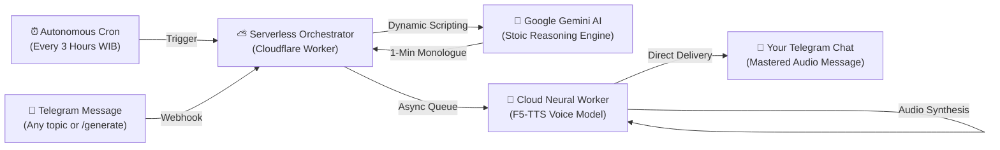

# 🎙️ Personal OS

> _"Hello, friend. It's happening again. They have us convinced that if we stop moving, we stop existing..."_

[](https://go.dev/)
[](documentation/CHANGELOG.md)
[](LICENSE)
[](https://core.telegram.org/bots/api)
[](https://workers.cloudflare.com/)
[](https://huggingface.co/)

**Personal OS** is an autonomous, 24/7 AI Audio Motivation Engine. It deconstructs modern fatigue, digital anxiety, and daily friction through the intimate, calculated, stoic consciousness of **Elliot Alderson (_Mr. Robot_)**.

Every 3 hours—or whenever you ask—it synthesizes a 1-minute voice monologue and delivers mastered, podcast-grade audio directly to your private Telegram chat.

---

## ✨ Highlights

- 🧠 **100% Dynamic Consciousness:** Powered by Google Gemini Flash. No static lists or repetitive clichés. It invents novel philosophical perspectives on treating reality as an open-world simulation and hacking your daily mental state.
- 🎙️ **Neural Voice Synthesis:** Uses deep diffusion voice cloning (**F5-TTS**) to recreate Elliot's distinctive quiet, intimate, analytical whisper.
- ⛅ **True $0 Serverless Infrastructure:** Runs 24/7 on free-tier edge computing (Cloudflare Workers Cron + Hugging Face Spaces + Telegram Bot API).
- 📲 **Interactive On-Demand Companion:** In addition to automated 3-hourly broadcasts, you can send any thought or topic in Telegram to get an immediate, personalized 1-minute audio debrief.

---

## 🏗️ How It Works



1. **The Spark:** Triggered automatically every 3 hours (00:00, 03:00, 06:00, 09:00, 12:00, 15:00, 18:00, 21:00 WIB) or instantly when you text the bot.
1. **The Mind:** Gemini Flash crafts a tightly calibrated ~120-word spoken monologue addressing modern friction.
1. **The Voice:** Hugging Face Spaces synthesizes speech via neural diffusion and optimizes loudness for mobile speakers.
1. **The Delivery:** The master audio file and telemetry arrive directly in your private Telegram feed.

---

## 📱 The Experience

Every delivery arrives cleanly formatted with actionable metadata:

```text
🎙️ Personal OS — Motivation Engine

📌 Topic: The Algorithmic Echo of Validation
📝 Summary: True autonomy is found by severing the feedback loop between your worth and digital metrics.
⏱️ Process Time: 48.2s
🪙 Tokens: 512 (120 in / 392 out)

"Hello, friend..."
▶️ [━━━━━━━●────────] 01:04 (High-Fidelity Audio)
```

### Interactive Commands

| Command / Input        | What Happens                                                                             |
| :--------------------- | :--------------------------------------------------------------------------------------- |
| `/generate`            | Generates a fresh audio on a novel, dynamically generated stoic topic.                   |
| `/generate <topic>`    | Generates a targeted audio around your chosen topic (e.g., `/generate burnout`).         |
| _`<any text message>`_ | Send any raw thought or vent; the engine deconstructs it into a 1-minute audio response. |
| `/ping`                | Runs live health diagnostics across Cloudflare, Gemini AI, Hugging Face TTS & Bot API.   |
| `/wake`                | Wakes up or restarts a sleeping Hugging Face TTS Space remotely from Telegram.           |
| `/status`              | Checks engine configuration and automated schedule information.                          |

---

## ⏰ Delivery Protocol (Every 6 Hours WIB)

| Time Window   | Jakarta Time (WIB)    | Mindset Objective                                                                      |
| :------------ | :-------------------- | :------------------------------------------------------------------------------------- |
| **Morning**   | **06:00 • 09:00 WIB** | Calibrate mental clarity and strip manufactured urgency before & during morning focus. |
| **Afternoon** | **12:00 • 15:00 WIB** | Cut through midday noise, fatigue, and meetings to regain deliberate focus.            |
| **Evening**   | **18:00 • 21:00 WIB** | Mental debrief, disconnect from the loop, and reclaim quiet autonomy.                  |
| **Night**     | **00:00 • 03:00 WIB** | Strip artificial weight and quiet the mind.                                            |

_(Need a mental reset anytime? Send `/generate`, `/ping` for live status, or `/wake` to wake up the TTS Space)._

---

## 📚 Technical Documentation

For engineers interested in the implementation details, deep-dive into our modular architecture and code:

- 🏛️ **[Architecture & Data Flow](documentation/ARCHITECTURE.md)** — In-depth breakdown of Go concurrency, FFmpeg mastering, and async queues.
- 📋 **[Product Requirements (PRD)](documentation/PRD.md)** — Acoustic guidelines, word pacing, and target specifications.
- 🗺️ **[Implementation Roadmap](documentation/IMPLEMENTATION_PLAN.md)** — Completed phases, milestones, and system checklist.
- 📜 **[Version Changelog](documentation/CHANGELOG.md)** — Semantic version history and release notes.

---

## ⚖️ Ethical Disclaimer

_Personal OS is an experimental, non-commercial educational research project exploring zero-shot neural voice diffusion, LLM reasoning, and serverless architectures. The voice persona is inspired by the fictional character Elliot Alderson from Mr. Robot._

---

## 📄 License

Distributed under the [MIT License](LICENSE). © 2026 Personal OS.
