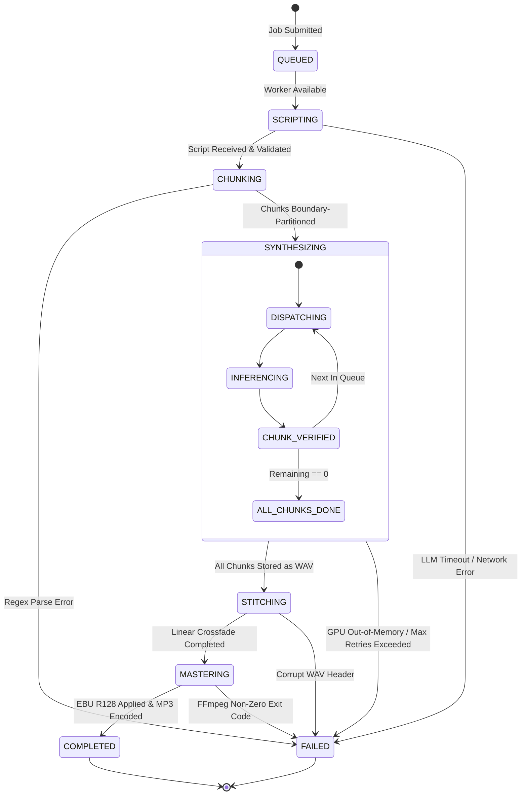
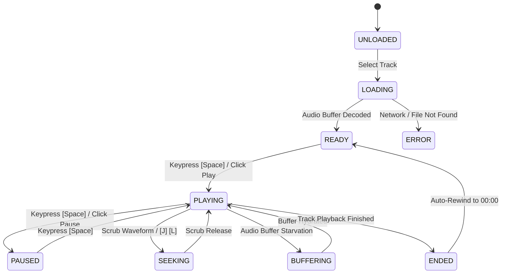

# Application Flow, State Machines & Screen Navigation
## Personal OS: AI Audio Motivation Engine

---

## 1. User Journey Maps

### 1.1 Primary Journey: On-Demand Session Generation

```mermaid
sequenceDiagram
    autonumber
    actor User as Focus Practitioner
    participant UI as Web Studio Console
    participant Orch as Go Orchestrator
    participant Worker as Python GPU Worker
    participant FFmpeg as FFmpeg Processor

    User->>UI: Selects Persona (Elliot Alderson) & Enters Topic ("Finishing the backend core")
    User->>UI: Clicks "Initiate Synthesis" (Ctrl + Enter)
    UI->>Orch: POST /api/v1/jobs (Create Job)
    Orch-->>UI: 201 Created (JobID, Status: QUEUED)
    UI->>Orch: Connects to SSE (/api/v1/jobs/{id}/events)
    
    rect rgb(15, 17, 23)
        Note over Orch: Internal Pipeline Processing
        Orch->>Orch: Generates Script via LLM (Tokens Streamed)
        Orch->>Orch: Splits Script into 150-250 char Chunks
        loop For each chunk (Concurrent Goroutines)
            Orch->>Worker: POST /v1/synthesize (Text + Ref Voice)
            Worker-->>Orch: 200 OK (Raw WAV Audio)
            Orch->>UI: SSE Event: chunk_completed (3/12)
        end
        Orch->>FFmpeg: Concatenate WAVs with 100ms Crossfade
        Orch->>FFmpeg: Mix Brown Noise & EBU R128 Normalization (-16 LUFS)
    end

    Orch-->>UI: SSE Event: job_completed (TrackID)
    UI->>User: Displays Interactive Waveform & Auto-Loads Player
    User->>UI: Hits [Space] to Play High-Immersion Audio
```



### 1.2 Secondary Journey: Voice Reference Ingestion
1. User enters **Voice Vault** screen.
2. Drags and drops a 10–15s `.wav` clip extracted from a film or speech.
3. System runs local analysis:
   - Validates sample rate ($\ge 24\text{ kHz}$) and checks for audio clipping.
   - Computes Signal-to-Noise Ratio (SNR). If background noise is detected, offers one-click automated vocal isolation via Demucs.
4. User enters the exact transcript of the clip (essential for F5-TTS zero-shot alignment).
5. User clicks **Verify Sample**: System synthesizes a 3-second test phrase to confirm timbre fidelity.
6. Persona is saved to the local database.

---

## 2. System State Machines

### 2.1 Render Job Lifecycle State Machine



### 2.2 Audio Player Playback State Machine



---

## 3. Screen Navigation & Hierarchy

The Web Studio Console follows a single-window, high-density layout:

```text
┌────────────────────────────────────────────────────────────────────────┐
│ [Personal OS]  [Studio]  [Voice Vault]  [Library]  [Telemetry]  [⚙]    │
├────────────────────────────────────────┬───────────────────────────────┤
│                                        │                               │
│  LEFT PANEL: SCRIPT & CONFIG           │  RIGHT PANEL: AUDIT & MONITOR │
│  ──────────────────────────────────    │  ──────────────────────────── │
│  Persona Selector:                     │  Live Waveform Display        │
│  [ Elliot Alderson ▼ ]                 │  ┌──────────────────────────┐ │
│                                        │  │ █ █ █ █ █ █ █ █ █ █ █ █  │ │
│  Topic / Introspective Directive:      │  └──────────────────────────┘ │
│  ┌──────────────────────────────────┐  │                               │
│  │ Break through the procrastination│  │  Multi-Track Ambient Mixer    │
│  │ fog on refactoring the engine... │  │  - Vocals:       [========]   │
│  └──────────────────────────────────┘  │  - Brown Noise:  [====    ]   │
│                                        │  - Rain Texture: [==      ]   │
│  Acoustic Style: [Whisper ▼]           │                               │
│  Duration: [15 Minutes ▼]              │  Terminal Output Log (SSE)    │
│                                        │  ┌──────────────────────────┐ │
│  [ INITIATE SYNTHESIS (Ctrl+Enter) ]   │  │ > Synthesizing chunk 4/12│ │
│                                        │  │ > GPU VRAM: 4.8 GB       │ │
│                                        │  └──────────────────────────┘ │
└────────────────────────────────────────┴───────────────────────────────┘
│  BOTTOM BAR: PERSISTENT MEDIA PLAYER CONTROLS                         │
│  [▶] 04:12 / 15:00 ───●──────────────────────────── 🔊 [=====] [M]   │
└────────────────────────────────────────────────────────────────────────┘
```

### Screen Directory & Roles

1. **Studio (`/studio`):** The primary workspace for prompt crafting, real-time job execution monitoring, and audio playback.
2. **Voice Vault (`/vault`):** Management of reference voices, vocal SNR validation, and audio isolation tools.
3. **Audio Library (`/library`):** Catalog of completed motivation sessions, export tools (`.mp3`/`.flac`), and favorite tracks.
4. **Telemetry & Logs (`/telemetry`):** Real-time monitoring of GPU VRAM, queue depth, RTF performance graphs, and system logs.
5. **Automation & Schedules (`/settings/cron`):** Configuration of daily morning generation triggers and notification webhooks.
