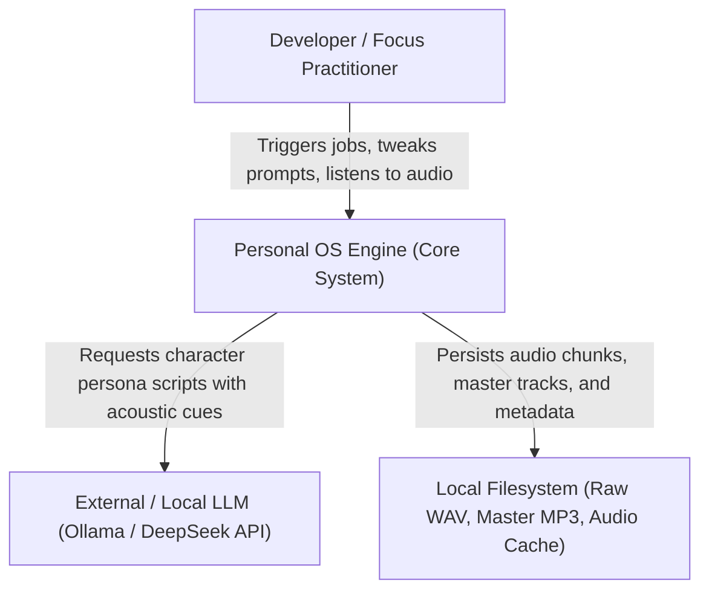
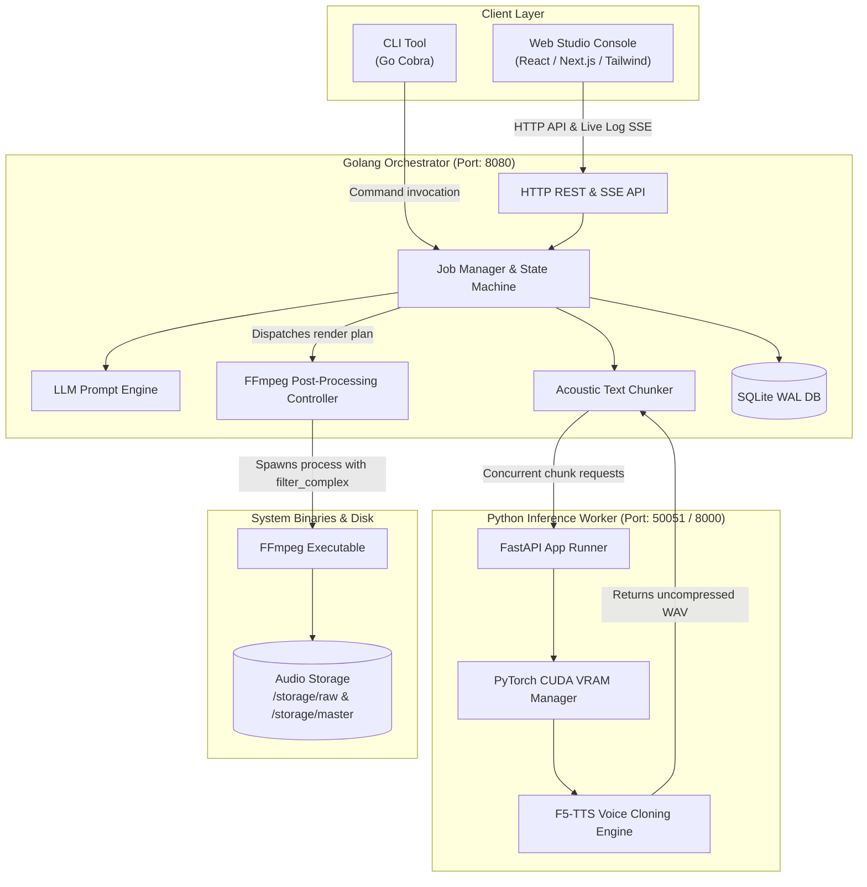

# Architectural Specification & System Topology
## Personal OS: AI Audio Motivation Engine

---

## 1. High-Level Architectural Pattern

Personal OS employs a **Hybrid Monorepo / Asynchronous Microservice** pattern designed to decouple high-concurrency orchestration logic from heavy, GPU-bound PyTorch neural network execution.

```text
┌────────────────────────────────────────────────────────────────────────┐
│                        User Interface Layer                            │
│  - Web Console (Next.js / React / Tailwind / Lucide)                   │
│  - CLI Operator (Go Cobra CLI)                                         │
└───────────────────────────────────┬────────────────────────────────────┘
                                    │ HTTP / WebSocket / SSE
                                    ▼
┌────────────────────────────────────────────────────────────────────────┐
│                   Golang Orchestration Engine                          │
│  - Job Dispatcher & State Machine (Go Concurrency)                    │
│  - LLM Prompting & Acoustic Directive Engine                           │
│  - Boundary-Aware Text Chunker (150–250 chars)                         │
│  - Audio Post-Processing Pipeline (FFmpeg Subprocess Runner)           │
│  - SQLite Database with WAL Mode (Persistence & Metadata)             │
└──────────────────┬─────────────────────────────────┬───────────────────┘
                   │                                 │
     HTTP/REST     ▼                                 ▼ Local Subprocess Exec
┌──────────────────────────────────────┐  ┌──────────────────────────────┐
│   Python Inference Worker (FastAPI)  │  │   FFmpeg Media Processor     │
│ - PyTorch 2.x CUDA/ROCm Runtime      │  │ - Audio Chunk Concatenation   │
│ - F5-TTS / Fish Speech Models        │  │ - 100ms Linear Crossfading    │
│ - Zero-Shot Voice Conditioning       │  │ - EBU R128 Loudness Normalizer│
│ - VRAM Memory Semaphore Management   │  │ - ASMR Ambient Layering       │
└──────────────────────────────────────┘  └──────────────────────────────┘
```

---

## 2. System Context & Container Model (C4 Level 1 & 2)

### 2.1 C4 Level 1: System Context Diagram



### 2.2 C4 Level 2: Container Diagram



---

## 3. Component Deep Dive

### 3.1 Golang Orchestration Engine (`apps/orchestrator`)
- **Job Dispatcher:** Manages rendering pipelines via Go channels and goroutine worker pools. Prevents overwhelming system resources by controlling concurrency levels.
- **Boundary-Aware Chunker:** Parses the generated script into acoustic fragments. Protects TTS engines from hallucinations by restricting input size to 150–250 characters while never cutting through clauses or bracketed directives (`[whisper]`, `[pause:2s]`).
- **FFmpeg Subprocess Controller:** Directs FFmpeg via strict parameter arrays (`exec.CommandContext`), dynamically generating multi-input `filter_complex` graphs for crossfading, loudness normalization, and ambient noise mixing.
- **Embedded Database:** Uses SQLite with Write-Ahead Logging (`PRAGMA journal_mode=WAL;`) for zero-overhead local transactional persistence of jobs, presets, and audio metadata.

### 3.2 Python Inference Worker (`apps/inference-worker`)
- **FastAPI / PyTorch Microservice:** Exposes `/v1/synthesize` and `/v1/health` endpoints.
- **Model Lifecycle:** Holds the pre-trained F5-TTS or Fish Speech weights loaded into GPU VRAM (FP16 precision) to eliminate cold-start latencies per request.
- **Memory Safety:** Implements an internal async semaphore (`asyncio.Semaphore(1)`) to serialize GPU tensor computations, combined with `torch.cuda.empty_cache()` hooks to prevent CUDA Out-Of-Memory (OOM) crashes.

### 3.3 Media Storage & Asset Management
- `/storage/references/`: Clean reference vocal audio files (10–15 seconds, mono, 24kHz/48kHz WAV) isolated from movies or speeches.
- `/storage/ambient/`: Seamless looping tracks for brown noise, rain, room tone, and tape hiss.
- `/storage/cache/`: Intermediate audio chunks indexed by chunk hash and session ID.
- `/storage/output/`: Final mastered audio files (`.mp3` @ 320kbps and `.flac`).

---

## 4. Project Directory Hierarchy

```text
personal-os/
├── apps/
│   ├── orchestrator/                 # Golang Backend & CLI
│   │   ├── cmd/
│   │   │   ├── server/main.go        # HTTP API & SSE server entrypoint
│   │   │   └── cli/main.go           # Terminal CLI entrypoint
│   │   ├── internal/
│   │   │   ├── domain/               # Domain models (Job, Track, Persona)
│   │   │   ├── chunker/              # Text parsing & boundary split logic
│   │   │   ├── prompt/               # LLM integration & prompt templates
│   │   │   ├── synthesizer/          # HTTP client to Python worker
│   │   │   ├── audio/                # FFmpeg wrapper & filter graph builder
│   │   │   └── repository/           # SQLite store & migrations
│   │   ├── go.mod
│   │   └── go.sum
│   ├── inference-worker/             # Python GPU Inference Microservice
│   │   ├── src/
│   │   │   ├── main.py               # FastAPI application
│   │   │   ├── engine/
│   │   │   │   ├── f5_tts.py         # F5-TTS model wrapper
│   │   │   │   └── audio_utils.py    # Resampling & normalization
│   │   │   └── config.py             # Model checkpoint paths & CUDA settings
│   │   ├── requirements.txt
│   │   └── Dockerfile.gpu
│   └── web-console/                  # React / Next.js Web Studio UI
│       ├── src/
│       │   ├── app/                  # Next.js App Router
│       │   ├── components/
│       │   │   ├── ui/               # Terminal Noir primitives
│       │   │   ├── visualizer/       # Canvas waveform visualizer
│       │   │   └── mixer/            # Ambient soundscape faders
│       │   ├── hooks/                # SSE log streaming & audio hooks
│       │   └── lib/                  # API client & formatting
│       ├── tailwind.config.js
│       └── package.json
├── docs/                             # Engineering & Product Documentation
│   ├── PRD.md
│   ├── DESIGN_SYSTEM.md
│   ├── ARCHITECTURE.md
│   ├── INTEGRATION.md
│   ├── TSD.md
│   ├── SECURITY_GUIDE.md
│   ├── APP_FLOW.md
│   ├── IMPLEMENTATION_PLAN.md
│   └── TESTING_GUIDE.md
├── storage/                          # Local Media & Database Mounts
│   ├── ambient/
│   ├── references/
│   ├── cache/
│   └── output/
├── scripts/                          # Diagnostic & Setup Scripts
│   ├── setup_models.sh
│   └── isolate_vocals.py
├── docker-compose.yml                # Multi-service local orchestrator
└── README.md
```

---

## 5. Data Flow & Communication Protocols

1. **Job Initialization:** Web UI or CLI sends `POST /api/v1/jobs` with persona settings and prompt directives to Go Orchestrator.
2. **Script Generation:** Go queries LLM provider (Ollama / DeepSeek) over HTTPS/REST with streaming token accumulation.
3. **Chunking & Dispatch:** Script is parsed into chunks. Goroutines dispatch `POST /v1/synthesize` requests containing base64/binary reference audio and target text to the Python worker.
4. **WAV Serialization:** Python worker returns raw PCM WAV data; Go writes files directly into `/storage/cache/{job_id}/`.
5. **Progress Telemetry:** Go streams execution logs and percentage progress to the Web UI via Server-Sent Events (`GET /api/v1/jobs/{id}/events`).
6. **Master Assembly:** Once all chunks are verified, Go invokes FFmpeg to stitch chunks, apply crossfades, overlay ambient audio, and perform EBU R128 loudness normalization.
