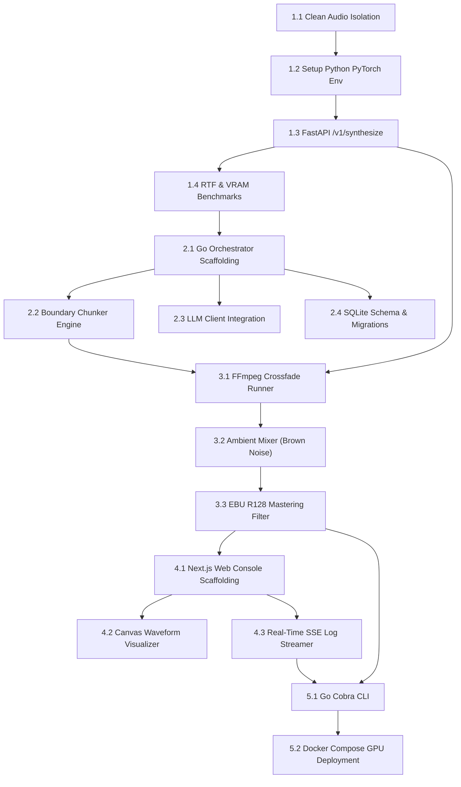

# Implementation Plan & Execution Roadmap
## Personal OS: AI Audio Motivation Engine

> **Operational Directive:**
> Gunakan daftar ceklis di bawah untuk melacak fitur yang sedang aktif dikerjakan. Sesuai protokol, **apabila suatu fitur telah selesai diimplementasikan dan diverifikasi, hilangkan baris fitur tersebut dari daftar ceklis aktif** agar dokumen tetap ringkas, bersih, dan hanya merefleksikan pekerjaan yang sedang berjalan (*WIP*).

---

## 1. Phase-Based Roadmap

| Fase | Fokus Utama | Target Deliverables | Estimasi | Status |
| :--- | :--- | :--- | :--- | :--- |
| **Fase 1** | **Acoustic & Voice Validation** | Sampel vokal bersih (Elliot & Batman), uji inferensi F5-TTS lokal, verifikasi RTF $\le 0.35$. | 3 Hari | `IN_PROGRESS` |
| **Fase 2** | **Core Orchestrator & Chunker** | Golang boundary chunker, integrasi client LLM (Ollama/DeepSeek), HTTP client ke worker Python. | 4 Hari | `PENDING` |
| **Fase 3** | **Audio Post-Processing Pipeline** | Golang FFmpeg runner, dynamic crossfade concatenation, EBU R128 loudness normalization, ambient mixer. | 4 Hari | `PENDING` |
| **Fase 4** | **Web Studio & Telemetry** | Terminal Noir UI (Next.js/Tailwind), visualizer canvas, SSE log streamer, multi-track mixer. | 5 Hari | `PENDING` |
| **Fase 5** | **Automation & Packaging** | Cron background trigger, CLI binary, Docker Compose GPU deployment, E2E stress testing. | 3 Hari | `PENDING` |

---

## 2. Active Feature Checklist (Work-in-Progress)

Daftar fitur yang sedang aktif dalam antrean pengerjaan. *(Hapus item dari daftar ini saat selesai diuji)*:

- [ ] **[Fase 1.1]** Ekstraksi dan isolasi vokal referensi karakter asli dalam Bahasa Inggris (Elliot Alderson / Batman 10–15s, mono, 48kHz WAV) bebas noise latar belakang.
- [ ] **[Fase 1.2]** Setup environment Python FastAPI + PyTorch CUDA dengan checkpoint model Fish Speech FP16 (Pendekatan A: Cross-Lingual).
- [ ] **[Fase 1.3]** Implementasi endpoint `POST /v1/synthesize` pada worker Python dan uji validasi kloning vokal lintas bahasa (sampel EN $\to$ sintesis teks Bahasa Indonesia 3–5 detik).
- [ ] **[Fase 1.4]** Pengukuran *Real-Time Factor* (RTF $\le 0.35$), audit artikulasi fonem Bahasa Indonesia, dan audit konsumsi VRAM pada GPU workstation.
- [ ] **[Fase 2.1]** Pembuatan struktur project Golang (`apps/orchestrator`) dengan Go modules dan internal domain boundaries.
- [ ] **[Fase 2.2]** Implementasi modul `chunker` di Go dengan regex boundary preservation untuk batas 150–250 karakter.
- [ ] **[Fase 2.3]** Implementasi Go HTTP client ke LLM provider (Ollama / DeepSeek) dengan streaming token buffer.
- [ ] **[Fase 2.4]** Implementasi SQLite storage dengan WAL mode untuk tabel `personas`, `render_jobs`, dan `job_chunks`.
- [ ] **[Fase 3.1]** Pembuatan builder parameter FFmpeg di Go untuk *linear crossfade* antar chunk audio.
- [ ] **[Fase 3.2]** Implementasi multi-input *audio mixing* (vokal + brown noise loop) dengan filter `amix`.
- [ ] **[Fase 3.3]** Penegakan normalisasi EBU R128 (`loudnorm=I=-16:LRA=7:TP=-1.5`) dan encoding master MP3 320kbps.
- [ ] **[Fase 4.1]** Inisialisasi frontend Web Studio (`apps/web-console`) dengan Tailwind CSS tokens *Terminal Noir*.
- [ ] **[Fase 4.2]** Komponen Canvas Waveform Visualizer & Audio Scrubber interaktif.
- [ ] **[Fase 4.3]** Hook SSE (`useJobLogs`) untuk streaming log real-time dari Go orchestrator ke web console.
- [ ] **[Fase 5.1]** CLI command `personal-os generate --persona elliot --topic "..."` menggunakan Go Cobra.
- [ ] **[Fase 5.2]** Konfigurasi Docker Compose untuk orkestrasi worker Python (GPU passthrough) dan backend Go.

---

## 3. Execution Dependency Graph

---

## 4. Critical Path & Blocker Mitigation

1. **GPU Worker Cold-Start Latency:**
   - *Risiko:* Python memuat model dari disk pada setiap request, menyebabkan lonjakan latensi.
   - *Solusi:* Model dimuat satu kali saat startup aplikasi FastAPI (`lifespan` handler) dan dipertahankan dalam memory VRAM.
2. **FFmpeg Filtergraph String Complexity:**
   - *Risiko:* Menjahit 40+ chunk dalam satu filtergraph dapat melebihi batas panjang argumen shell sistem operasi.
   - *Solusi:* Gunakan *concat demuxer file list* untuk rekonsiliasi chunk dasar, kemudian terapkan filter ambient dan loudnorm pada pass kedua.
