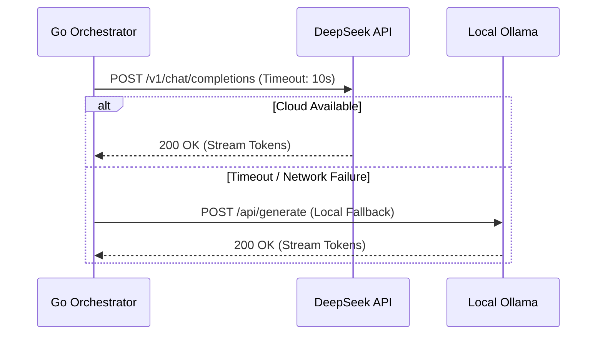

# Integration Contracts & Third-Party Service Specifications

## Personal OS: AI Audio Motivation Engine

---

## 1. Internal Microservice Contract: Go Orchestrator $\leftrightarrow$ Python GPU Worker

The Golang Orchestrator coordinates with the Python Inference Worker over HTTP/1.1 (JSON metadata + base64/binary audio payload).

### 1.1 Endpoint: Voice Synthesis (`POST /v1/synthesize`)

Dispatches an atomic text chunk along with a reference voice clip for zero-shot voice cloning.

#### Request Headers

```http
POST /v1/synthesize HTTP/1.1
Host: localhost:8000
Content-Type: application/json
Accept: audio/wav
X-Request-ID: req_01HV7Y4AB892KC8E7F3
X-Job-ID: job_01HV7Y39C7621MA98DF
```

#### Request Payload (Approach A: Cross-Lingual Synthesis)

```json
{
  "chunk_id": "chunk_004",
  "text": "Keheningan di ruangan ini bukan ruang kosong. Ini penuh dengan jawaban yang selama ini kamu hindari.",
  "target_language": "id",
  "acoustic_directives": {
    "style": "whisper",
    "speed": 0.95,
    "pitch_shift": -1.5,
    "pause_duration_ms": 300
  },
  "reference_audio": {
    "persona_id": "elliot_alderson",
    "ref_audio_path": "/storage/references/elliot_clean_12s.wav",
    "ref_text": "Hello, friend. Hello, friend? That's lame. Maybe I should give you a name.",
    "ref_language": "en"
  },
  "model_config": {
    "engine": "fish-speech",
    "nfe_steps": 32,
    "cfg_strength": 2.0,
    "temperature": 0.7
  }
}
```

#### Successful Response (`200 OK`)

- **Content-Type:** `audio/wav`
- **Headers:**
  - `X-Compute-Time-Ms`: `1450`
  - `X-RTF`: `0.28`
  - `X-VRAM-Used-MB`: `4310`
- **Body:** Binary uncompressed PCM WAV audio stream (24-bit, 48kHz, mono).

---

### 1.2 Endpoint: Worker Health & Telemetry (`GET /v1/health`)

Used by the Go Orchestrator for readiness probing and adaptive concurrency throttling.

#### Response Payload (`200 OK`)

```json
{
  "status": "HEALTHY",
  "version": "1.2.0",
  "gpu": {
    "device_name": "NVIDIA GeForce RTX 4090",
    "cuda_version": "12.2",
    "total_vram_mb": 24564,
    "used_vram_mb": 5120,
    "free_vram_mb": 19444,
    "temperature_celsius": 48
  },
  "active_jobs": 1,
  "queue_depth": 0,
  "loaded_models": ["f5-tts-v1-fp16"]
}
```

---

## 2. External LLM Provider Integration

The Go Orchestrator interfaces with LLMs to generate high-immersion psychological scripts. It supports dual-mode integration: Local (Ollama) and Cloud (DeepSeek / OpenAI compatible API).

### 2.1 Provider Cascading Strategy

1. **Primary Target:** DeepSeek-Chat / DeepSeek-V3 API (Superior philosophical, introspective writing).
2. **Offline / Fallback Target:** Local Ollama running `llama3:8b-instruct-q8_0` or `mistral:7b`.



### 2.2 LLM Request Contract (Indonesian Psychological Script Generation)

```json
{
  "model": "deepseek-chat",
  "messages": [
    {
      "role": "system",
      "content": "Kamu adalah Elliot Alderson dari serial Mr. Robot. Bicaralah dalam monolog batin yang intim, berbisik, jujur, dan tajam dalam Bahasa Indonesia. Gunakan kalimat yang singkat dan berbobot tanpa klise motivasi murahan. Sisipkan tag akustik secara terencana: [whisper], [sigh], [pause], dan elipsis (...)."
    },
    {
      "role": "user",
      "content": "Buatkan naskah meditasi fokus 10 menit untuk menembus kelelahan mental, mengatasi keraguan diri, dan menyelesaikan kode backend yang belum tuntas."
    }
  ],
  "temperature": 0.72,
  "max_tokens": 4000,
  "stream": true
}
```

---

## 3. Webhook Notifications: Job Lifecycle Events

Personal OS can dispatch webhooks to notify external clients (e.g., Discord or Telegram bots) when a long-form audio generation job concludes.

### 3.1 Webhook Payload (`POST`)

#### Headers

```http
Content-Type: application/json
X-Signature-SHA256: 7f83b1657ff1fc53b92dc18148a1d65dfc2d4b1fa3d677284addd200126d9069
X-Event-Type: audio.job.completed
```

#### Payload

```json
{
  "event": "audio.job.completed",
  "timestamp": "2026-11-16T20:55:00.000Z",
  "data": {
    "job_id": "job_01HV7Y39C7621MA98DF",
    "persona": "elliot_alderson",
    "title": "Conquering The Panic Daemon",
    "duration_seconds": 942.5,
    "metrics": {
      "chunks_count": 48,
      "total_render_time_seconds": 184.2,
      "overall_rtf": 0.19,
      "loudness_lufs": -16.02
    },
    "download_url": "/api/v1/tracks/trk_01HV7Y98A190/download",
    "file_size_bytes": 37701120
  }
}
```

---

## 4. Standardized Error Payloads (RFC 7807)

All internal and external endpoints adhere to the **RFC 7807 Problem Details** specification:

```json
{
  "type": "https://personal-os.local/errors/gpu-vram-exhausted",
  "title": "GPU VRAM Allocation Failure",
  "status": 503,
  "detail": "Inference worker failed to allocate 1,200 MB tensor during F5-TTS forward pass. Active VRAM was 98.4%.",
  "instance": "/api/v1/jobs/job_01HV7Y39C7621MA98DF/chunks/chunk_014",
  "error_code": "ERR_GPU_OOM",
  "retryable": true,
  "backoff_ms": 3000
}
```

### Common Error Codes

| Error Code                    | HTTP Status | Description                                                    | Recovery Action                                                                             |
| :---------------------------- | :---------- | :------------------------------------------------------------- | :------------------------------------------------------------------------------------------ |
| `ERR_INVALID_REFERENCE_AUDIO` | `422`       | Reference file contains too much background noise or clipping. | Prompt user to upload a cleaner vocal sample or run voice isolation script.                 |
| `ERR_CHUNK_LENGTH_EXCEEDED`   | `400`       | Text chunk exceeds 300 characters without boundary.            | Chunker automatically subdivides based on word spacing.                                     |
| `ERR_GPU_OOM`                 | `503`       | CUDA memory allocation failed on Python worker.                | Go client initiates exponential backoff with jitter and triggers worker garbage collection. |
| `ERR_FFMPEG_FILTER_FAIL`      | `500`       | Syntax error in multi-input `filter_complex` command.          | Log failing filter string to `/var/log/ffmpeg.err` and trigger debug dump.                  |

---

## 5. Resilience, Retry Budgets & Jitter Protocols

- **Idempotency Guarantee:** Every chunk synthesis and job creation request must include a unique `X-Request-ID` or `X-Job-ID` header. Duplicate requests within a 30-minute window are served from the local disk cache without re-invoking the GPU.
- **Exponential Backoff with Full Jitter:**
  $$\text{Sleep} = \text{random}(0, \min(M, B \times 2^{\text{attempt}}))$$
  Where base $B = 500\text{ ms}$, maximum backoff $M = 8000\text{ ms}$.
- **Circuit Breaker:** If 3 consecutive requests to the GPU worker fail with `503 Service Unavailable`, the Go Orchestrator trips the circuit breaker for 30 seconds, pausing job dispatch to avoid compounding GPU driver panics.
