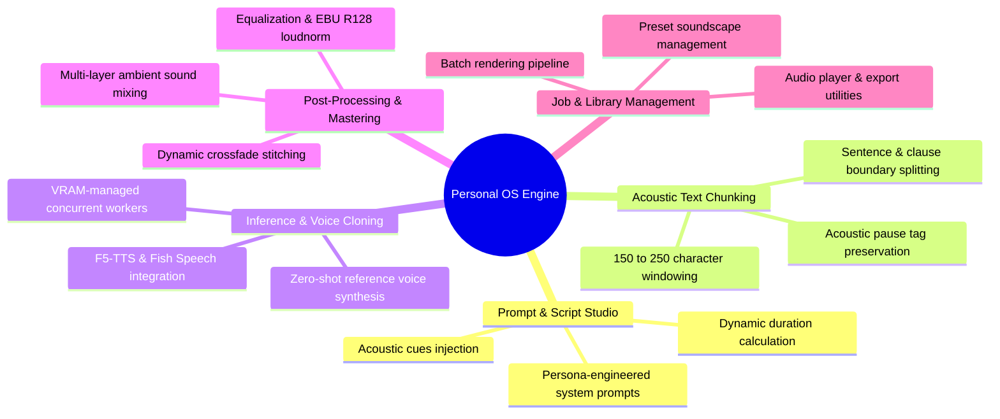

# Product Requirements Document (PRD)

## Personal OS: AI Audio Motivation Engine

---

## 1. Executive Summary & Vision

**Personal OS** is an automated, high-fidelity multimedia pipeline engineered to synthesize long-form (15 to 45 minutes), psychologically immersive motivational audio soundscapes. Departing from conventional high-energy or corporate self-help tropes, Personal OS draws upon the gritty, existential, and introspective tonality of archetypal characters—specifically Elliot Alderson (_Mr. Robot_) and Batman / The Dark Knight—layered over calming, meditative ASMR textures (whispers, breath pauses, brown noise, gentle rain, and vinyl crackle).

The platform bridges a high-performance **Golang** orchestration engine with a dedicated **Python/PyTorch** GPU inference microservice (hosting zero-shot voice cloning models such as F5-TTS or Fish Speech). The end product serves as a daily psychological focal point for software engineers, deep-work practitioners, and thinkers operating in high-stress, high-cognitive-load environments.

---

## 2. Problem Statement & Target Personas

### 2.1 The Problem

- **Superficial Motivation Fatigue:** Mainstream motivational content is loud, manic, generic, and unhelpful for deep technical concentration.
- **Audio Degradation in Long-Form TTS:** Existing cloud TTS systems exhibit robotic cadence, pitch shifts, or hallucinations when processing text longer than 2 to 3 minutes continuously.
- **Lack of Acoustic Texture:** Traditional voice generators produce dry, studio-sterile vocals that lack intimate spatial cues (breath, room reflections, atmospheric soundscapes) vital for ASMR-style focus induction.
- **High Resource Overhead:** Content creators and solo practitioners lack a unified, local-first engine that automates scripting, voice synthesis, multi-track mixing, and master rendering seamlessly.

### 2.2 User Personas

| Persona       | Role                        | Core Need                                                                                              | Key Value Proposition                                                                                                   |
| :------------ | :-------------------------- | :----------------------------------------------------------------------------------------------------- | :---------------------------------------------------------------------------------------------------------------------- |
| **Alex, 29**  | Senior Backend Engineer     | Needs intense focus during late-night code sprints; suffers from burnout and cognitive exhaustion.     | Quiet, razor-sharp existential motivation in Elliot Alderson's whispering cadence mixed with low-frequency brown noise. |
| **David, 34** | Startup Founder / Architect | Seeks stoic resilience and discipline without platitudes before high-stakes presentations or workouts. | Deep, gravelly voice synthesis reminiscent of Batman over subtle dark ambient drone and rainfall.                       |
| **Maya, 26**  | Research Scientist          | Experiences high sensory overload; requires calm, intimate auditory focus to read dense papers.        | ASMR-level soft-spoken narration with precise dynamic pacing and zero abrupt volume spikes.                             |

---

## 3. Product Scope & Functional Specifications

### 3.1 Feature Breakdown

### 3.2 Epics & User Stories

#### Epic 1: Autonomous Script Generation (Indonesian Monologue)

- **US-1.1:** As a user, I want the system to generate philosophical, psychological motivation scripts in fluent, introspective Indonesian based on selected character presets (e.g., Elliot Alderson, Batman, The Stoic) so that the tone matches my current mental focus need.
- **US-1.2:** As an engineer, I want the LLM to output custom acoustic tags (e.g., `[whisper]`, `[sigh]`, `[pause:2s]`, `[low-pitch]`) so that the downstream voice cloner respects emotional delivery and pacing.
- **Acceptance Criteria:**
  - Generated scripts must strictly adhere to character persona constraints defined in system prompts using deep, literary Indonesian phrasing.
  - Scripts must be grammatically partitioned into natural breath pauses.
  - Fallback logic to local LLM (Ollama / Llama-3) if external APIs fail or are offline.

#### Epic 2: Intelligent Text Chunking & Concurrency

- **US-2.1:** As an orchestrator, I want long text documents split into discrete fragments of 150–250 characters along sentence or clause boundaries so that the TTS model never hallucinates or suffers prosody drift.
- **US-2.2:** As an operator, I want Golang to concurrently dispatch chunk synthesis jobs to the Python GPU worker bounded by a worker pool so that GPU VRAM is never saturated.
- **Acceptance Criteria:**
  - No text chunk may split a word or an acoustic directive tag.
  - All chunks must maintain an explicit sequence index (`chunk_001.wav`, `chunk_002.wav`) for deterministic reconstruction.

#### Epic 3: Cross-Lingual Voice Cloning & Speech Synthesis (Fish Speech)

- **US-3.1:** As a user, I want to provide a clean 10–15 second audio reference sample of my target character in English (e.g., Elliot Alderson audio + English transcript) and have the system synthesize the voice speaking Indonesian seamlessly without fine-tuning (Approach A: Cross-Lingual Zero-Shot).
- **US-3.2:** As a listener, I want speech inference output to maintain vocal timbre fidelity, whisper textures, and natural vocal fry in Indonesian without sounding like a foreign robotic accent.
- **Acceptance Criteria:**
  - Primary synthesis engine standardized on Fish Speech for robust cross-lingual conditioning.
  - Real-Time Factor (RTF) $\le 0.35$ on an NVIDIA RTX 3060/4090.
  - Natural Indonesian prosody and correct syllable stress on common technical and philosophical vocabulary.

#### Epic 4: ASMR Audio Mastering & Multi-Track Mixing

- **US-4.1:** As a listener, I want the system to seamlessly concatenate speech chunks with 50–150ms dynamic crossfades to eliminate abrupt clicks and pop sounds.
- **US-4.2:** As a listener, I want to blend ambient textures (brown noise, rainfall, subtle tape hiss) under the vocal track at configurable volume ratios (e.g., -18dB relative to dialogue).
- **US-4.3:** As an audiophile, I want the final render normalized to EBU R128 standards (-16 LUFS for podcasts/headphones) so that the volume is consistent and pleasant.
- **Acceptance Criteria:**
  - Total silence between stitched chunks must not exceed 250ms unless an explicit `[pause]` tag is present.
  - Integrated loudness must match $-16 \pm 1$ LUFS with a maximum true peak of $-1.5$ dBFS.

---

## 4. Target Metrics & KPIs

| Metric                                | Target Standard               | Measurement / Validation Method                            |
| :------------------------------------ | :---------------------------- | :--------------------------------------------------------- |
| **Inference Real-Time Factor (RTF)**  | $\le 0.30$                    | Total audio generated / GPU compute seconds.               |
| **15-Minute Audio Render Duration**   | $\le 4.5$ minutes total       | Stopwatch measurement from trigger to final `.mp3` output. |
| **Chunk Stitching Boundary Glitches** | $0$ perceptible clicks/pops   | Automated spectrum RMS check at junction coordinates.      |
| **Master Audio Loudness**             | $-16 \text{ LUFS } (\pm 1.0)$ | EBU R128 analysis via `ffmpeg loudnorm`.                   |
| **API Latency (Go Orchestrator)**     | $p99 \le 35\text{ ms}$        | Prometheus metrics on internal dispatch endpoints.         |
| **GPU Memory Consumption**            | $\le 6.5\text{ GB VRAM}$      | Monitored via `nvidia-smi` during peak batch inference.    |

---

## 5. Non-Functional Requirements & Constraints

1. **Hardware Operating Budget:** The system must run smoothly on consumer-grade workstation GPUs (minimum 8GB VRAM, e.g., RTX 3060/4060 or Apple Silicon unified memory).
2. **Offline-First Resilience:** The architecture must be fully operational without an internet connection when paired with local models (Ollama for LLM, local PyTorch checkpoint for F5-TTS).
3. **Storage & Format Integrity:** Intermediate chunk files must be stored as uncompressed 24-bit 48kHz WAV to preserve full acoustic dynamic range before final MP3/FLAC encoding.
4. **Deterministic Reproducibility:** Every generated track must record its random seed, prompt hash, chunk map, and model checkpoint ID into an accompanying metadata `.json` file.
