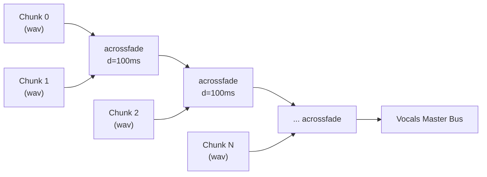

# Technical Specification Document (TSD)
## Personal OS: AI Audio Motivation Engine

---

## 1. Database Architecture & Relational Schema

The Go Orchestrator uses **SQLite 3** operating in **WAL mode (Write-Ahead Logging)** with foreign key enforcement enabled (`PRAGMA foreign_keys = ON; PRAGMA journal_mode = WAL;`). This provides enterprise-grade transactional consistency (ACID) with sub-millisecond query latencies and zero external database container dependencies.

```sql
-- 1. Personas (Archetype Definitions)
CREATE TABLE personas (
    id VARCHAR(36) PRIMARY KEY,
    name VARCHAR(64) NOT NULL UNIQUE,          -- e.g., 'elliot_alderson', 'batman_dark_knight'
    display_title VARCHAR(128) NOT NULL,       -- e.g., 'Elliot Alderson (Mr. Robot)'
    description TEXT NOT NULL,
    default_system_prompt TEXT NOT NULL,
    default_cfg_strength REAL NOT NULL DEFAULT 2.0,
    created_at DATETIME NOT NULL DEFAULT CURRENT_TIMESTAMP,
    updated_at DATETIME NOT NULL DEFAULT CURRENT_TIMESTAMP
);

-- 2. Reference Audio Samples (Clean Vocals for Zero-Shot Cloning)
CREATE TABLE reference_audios (
    id VARCHAR(36) PRIMARY KEY,
    persona_id VARCHAR(36) NOT NULL,
    file_path VARCHAR(255) NOT NULL,
    transcript TEXT NOT NULL,                  -- Reference transcript required for F5-TTS
    duration_ms INTEGER NOT NULL,              -- 10,000ms - 15,000ms
    sample_rate INTEGER NOT NULL DEFAULT 48000,
    snr_db REAL NOT NULL,                      -- Signal-to-noise ratio
    is_active BOOLEAN NOT NULL DEFAULT 1,
    created_at DATETIME NOT NULL DEFAULT CURRENT_TIMESTAMP,
    CONSTRAINT fk_ref_persona FOREIGN KEY (persona_id) REFERENCES personas(id) ON DELETE CASCADE
);

-- 3. Render Jobs (Pipeline Execution Sessions)
CREATE TABLE render_jobs (
    id VARCHAR(36) PRIMARY KEY,
    persona_id VARCHAR(36) NOT NULL,
    title VARCHAR(255) NOT NULL,
    status VARCHAR(32) NOT NULL DEFAULT 'QUEUED', -- QUEUED, SCRIPTING, CHUNKING, SYNTHESIZING, STITCHING, MASTERING, COMPLETED, FAILED
    error_message TEXT NULL,
    raw_prompt TEXT NOT NULL,
    generated_script TEXT NULL,
    total_chunks INTEGER NOT NULL DEFAULT 0,
    completed_chunks INTEGER NOT NULL DEFAULT 0,
    ambient_preset VARCHAR(64) NOT NULL DEFAULT 'brown_noise_rain',
    loudness_target_lufs REAL NOT NULL DEFAULT -16.0,
    output_track_id VARCHAR(36) NULL,
    started_at DATETIME NULL,
    completed_at DATETIME NULL,
    created_at DATETIME NOT NULL DEFAULT CURRENT_TIMESTAMP,
    CONSTRAINT fk_job_persona FOREIGN KEY (persona_id) REFERENCES personas(id) ON DELETE RESTRICT
);
CREATE INDEX idx_jobs_status ON render_jobs(status);
CREATE INDEX idx_jobs_created_at ON render_jobs(created_at DESC);

-- 4. Job Chunks (Subdivided Speech Fragments)
CREATE TABLE job_chunks (
    id VARCHAR(36) PRIMARY KEY,
    job_id VARCHAR(36) NOT NULL,
    sequence_index INTEGER NOT NULL,           -- 0, 1, 2, ...
    text_content TEXT NOT NULL,
    acoustic_tag VARCHAR(32) NULL,             -- 'whisper', 'sigh', 'pause', 'monotone'
    status VARCHAR(32) NOT NULL DEFAULT 'PENDING', -- PENDING, DISPATCHED, SYNTHESIZED, FAILED
    wav_path VARCHAR(255) NULL,
    duration_ms INTEGER NULL,
    inference_time_ms INTEGER NULL,
    retry_count INTEGER NOT NULL DEFAULT 0,
    created_at DATETIME NOT NULL DEFAULT CURRENT_TIMESTAMP,
    CONSTRAINT fk_chunk_job FOREIGN KEY (job_id) REFERENCES render_jobs(id) ON DELETE CASCADE,
    CONSTRAINT uq_job_sequence UNIQUE (job_id, sequence_index)
);
CREATE INDEX idx_chunks_job ON job_chunks(job_id, sequence_index);

-- 5. Master Output Tracks (Audio Library)
CREATE TABLE tracks (
    id VARCHAR(36) PRIMARY KEY,
    job_id VARCHAR(36) NOT NULL UNIQUE,
    persona_id VARCHAR(36) NOT NULL,
    title VARCHAR(255) NOT NULL,
    file_path_mp3 VARCHAR(255) NOT NULL,
    file_path_flac VARCHAR(255) NULL,
    duration_seconds REAL NOT NULL,
    integrated_lufs REAL NOT NULL,
    true_peak_dbfs REAL NOT NULL,
    file_size_bytes INTEGER NOT NULL,
    created_at DATETIME NOT NULL DEFAULT CURRENT_TIMESTAMP,
    CONSTRAINT fk_track_job FOREIGN KEY (job_id) REFERENCES render_jobs(id) ON DELETE RESTRICT,
    CONSTRAINT fk_track_persona FOREIGN KEY (persona_id) REFERENCES personas(id) ON DELETE RESTRICT
);
```

---

## 2. Core Algorithmic Designs

### 2.1 Algorithm 1: Boundary-Aware Acoustic Text Chunker
TTS models degrade severely when sentence boundaries exceed 250 characters or when split mid-sentence. The chunking algorithm preserves punctuation marks and acoustic control directives.

```text
Algorithm: ChunkScript(Script: String, MinSize: Int = 150, MaxSize: Int = 250) -> List[Chunk]
1. Normalize whitespace and preserve bracketed tags: [whisper], [sigh], [pause:\d+s].
2. Tokenize script into primary clauses using regex delimiters: ([.!?…\n]+).
3. Initialize CurrentBuffer = "", Sequence = 0, OutputList = [].
4. For each Clause in Clauses:
    a. If Length(CurrentBuffer + Clause) <= MaxSize:
         CurrentBuffer += " " + Clause
    b. Else:
         If Length(CurrentBuffer) >= MinSize:
             Append (Sequence++, ExtractDirective(CurrentBuffer), CurrentBuffer) to OutputList
             CurrentBuffer = Clause
         Else:
             Subdivide Clause by commas/semicolons and greedily pack into CurrentBuffer.
5. If CurrentBuffer is not empty:
    Append (Sequence++, ExtractDirective(CurrentBuffer), CurrentBuffer) to OutputList.
6. Return OutputList.
```

### 2.2 Algorithm 2: Deterministic Audio Concatenation & Crossfade Graph
To stitch $N$ consecutive chunks seamlessly, Go generates an automated multi-input FFmpeg `filter_complex` execution graph.

For chunks $C_0, C_1, \dots, C_{N-1}$ with a 100ms crossfade duration ($d = 0.1\text{ s}$):

$$\text{acrossfade} = \text{duration}=0.1 : \text{curve1}=\text{tri} : \text{curve2}=\text{tri}$$



### 2.3 Algorithm 3: Multi-Track ASMR Mixing & EBU R128 Normalization
```text
Inputs:
  - In[0]: Vocals Master Bus
  - In[1]: Brown Noise Loop (Volume attenuated by -18 dB)
  - In[2]: Gentle Rain Texture (Volume attenuated by -22 dB)

Filter Pipeline:
1. Mix inputs: amix=inputs=3:duration=first:dropout_transition=2
2. Loudness normalization: loudnorm=I=-16:LRA=7:TP=-1.5
3. Output encoding: libmp3lame (320kbps, 48kHz, stereo)
```

---

## 3. Internal Go Interfaces & Data Structures

```go
package domain

import (
	"context"
	"io"
	"time"
)

// AcousticDirective defines vocal delivery parameters.
type AcousticDirective struct {
	Style           string  `json:"style"`             // "whisper", "monotone", "gritty"
	Speed           float64 `json:"speed"`             // 0.8 to 1.2
	PitchShift      float64 `json:"pitch_shift"`       // Semitones
	PauseDurationMs int     `json:"pause_duration_ms"` // Explicit trailing silence
}

// Chunk represents a discrete synthesized text unit.
type Chunk struct {
	ID            string            `json:"id"`
	JobID         string            `json:"job_id"`
	SequenceIndex int               `json:"sequence_index"`
	Text          string            `json:"text"`
	Directive     AcousticDirective `json:"directive"`
	WavPath       string            `json:"wav_path,omitempty"`
	DurationMs    int               `json:"duration_ms,omitempty"`
}

// Synthesizer specifies the external contract to the Python GPU worker.
type Synthesizer interface {
	SynthesizeChunk(ctx context.Context, chunk Chunk, refAudioPath string, refText string) ([]byte, error)
	CheckHealth(ctx context.Context) (WorkerTelemetry, error)
}

// AudioProcessor controls FFmpeg rendering and mastering.
type AudioProcessor interface {
	StitchChunks(ctx context.Context, chunkPaths []string, crossfadeMs int, outputPath string) error
	MixAmbientLayers(ctx context.Context, vocalPath string, ambientPaths []string, targetLUFS float64, outputPath string) error
	GetAudioMetadata(ctx context.Context, filePath string) (AudioMetadata, error)
}

// PromptEngine generates scripts using local or cloud LLMs.
type PromptEngine interface {
	GenerateScript(ctx context.Context, personaName string, topicPrompt string) (string, error)
}

// JobRepository persists and tracks rendering pipeline lifecycles.
type JobRepository interface {
	CreateJob(ctx context.Context, job *RenderJob) error
	GetJobByID(ctx context.Context, id string) (*RenderJob, error)
	UpdateJobStatus(ctx context.Context, id string, status string, errDesc string) error
	SaveChunkResult(ctx context.Context, chunkID string, wavPath string, durationMs int) error
}
```

---

## 4. Concurrency Management & Memory Footprints

### 4.1 Go Concurrency Controls
- **Worker Pool Sizing:** Goroutines making synthesis requests are bounded by a buffered channel semaphore (`make(chan struct{}, maxConcurrent)`).
- Default concurrency: `maxConcurrent = 2` on standard consumer GPUs (prevents Python FastAPI worker from thrashing CUDA VRAM).

### 4.2 Python GPU Memory Safeguards
- **Inference Locking:** Python worker uses `asyncio.Lock()` around the neural network forward pass:
  ```python
  async with gpu_lock:
      audio_tensor = model.infer(text, ref_audio)
      torch.cuda.empty_cache()
  ```
- **Garbage Collection:** Enforces deterministic VRAM cleanup following each completed batch.
